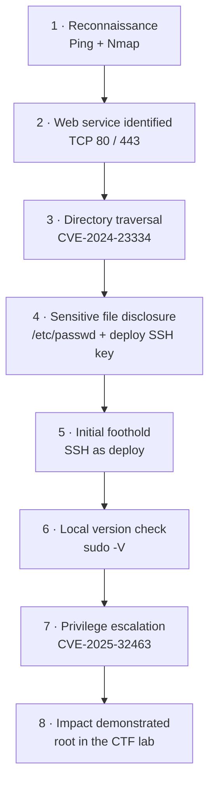

# Driftnet — Linux CTF Write-up

> **Objective:** obtain an initial foothold through a web directory-traversal flaw, then escalate from the `deploy` account to `root` through a vulnerable `sudo` chroot implementation.
> 
**Focus areas:** Linux enumeration · Web path traversal · SSH key exposure · Local privilege escalation

| Stage | Finding | Outcome |
|---|---|---|
| Reconnaissance | TCP services on 22, 80, 443 | Attack surface identified |
| Initial access | CVE-2024-23334 — directory traversal | Sensitive file disclosure; SSH key exposure |
| Foothold | SSH as `deploy` | Low-privileged shell |
| Privilege escalation | CVE-2025-32463 — sudo chroot handling | Root access in the lab |

> **Lab-only:** This write-up documents an authorized CTF exercise. Do not test these techniques against systems without explicit permission. The original lab notes contain sensitive key material; private keys, tokens, passwords, and other secrets must never be committed.

## Attack path



## 1. Reconnaissance

The target was checked for reachability, followed by a full TCP port scan and service/version enumeration. Ports **22 (SSH), 80 (HTTP), and 443 (HTTPS)** were reported as open in the lab notes.

Example commands used during enumeration:

```bash
ping -c 3 <TARGET_IP>
nmap -p- --min-rate 1000 -oN nmap-all-ports.txt <TARGET_IP>
nmap -sC -sV -p 22,80,443 -oN nmap-services.txt <TARGET_IP>
```

Use the actual target address only inside your authorized lab. Save scan output as evidence and redact any sensitive environment details before publishing.

## 2. Initial access — CVE-2024-23334

**Issue:** directory traversal in affected `aiohttp` static-resource configurations can allow a remote user to read files outside the intended static directory. The upstream advisory specifically describes static routes configured with `follow_symlinks=True`; the fix was released in **aiohttp 3.9.2**. See the [upstream advisory](https://github.com/aio-libs/aiohttp/security/advisories/GHSA-5h86-8mv2-jq9f).

**Observed in this lab:** traversal was used to read `/etc/passwd`, identify the `deploy` account, and expose its SSH private key. That key enabled SSH access as `deploy`.

**Impact**
- Confidentiality loss through arbitrary file reads.
- Exposure of credentials that can turn a file-read issue into account access.
- Potential lateral movement or further compromise, depending on the exposed files and key permissions.

**Important verification note:** the original notes identify the CVE but do not record the target's exact `aiohttp` version or static-route configuration. Treat the CVE attribution as the lab's reported finding until those details are captured.

## 3. Privilege escalation — CVE-2025-32463

**Issue:** a flaw in `sudo`'s `--chroot` / `-R` handling could allow a local user to gain root privileges by causing user-controlled configuration (including `nsswitch.conf`) to be used from the selected chroot. Upstream fixes are available in **sudo 1.9.17p1 and later**; distributions may backport fixes, so verify the vendor's package advisory as well. See the [GitHub advisory](https://github.com/advisories/GHSA-695j-c63m-mvxc) and [sudo security information](https://www.sudo.ws/security/advisories/).

**Observed in this lab:** the `sudo` version was checked after obtaining the `deploy` shell. A public proof of concept was transferred into the lab and executed, resulting in root access.

**Impact:** local privilege escalation from a low-privileged account to full system control.

## 4. MITRE ATT&CK mapping

This mapping describes the techniques reflected in the notes; it is not a claim that every technique was independently verified by telemetry.

| Activity | ATT&CK technique | Rationale |
|---|---|---|
| Network/service enumeration | [T1046 — Network Service Discovery](https://attack.mitre.org/techniques/T1046/) | Nmap was used to identify exposed services. |
| Vulnerability-focused probing | [T1595.002 — Vulnerability Scanning](https://attack.mitre.org/techniques/T1595/002/) | Service/version information was used to investigate likely vulnerabilities. |
| Reading sensitive local files | [T1005 — Data from Local System](https://attack.mitre.org/techniques/T1005/) | Traversal exposed local account data and an SSH private key. |
| SSH using the exposed key | [T1078 — Valid Accounts](https://attack.mitre.org/techniques/T1078/) | A recovered credential was used to authenticate as `deploy`. |
| Local privilege escalation | [T1068 — Exploitation for Privilege Escalation](https://attack.mitre.org/techniques/T1068/) | A local `sudo` vulnerability was exploited to obtain root. |

## 5. Evidence and reproducibility

The original screenshots have not yet been added to this repository. They are **not represented here as if they had been uploaded**; use the evidence checklist to transfer reviewed, redacted images into the repository.

Use [`docs/EVIDENCE.md`](docs/EVIDENCE.md) for the screenshot checklist and safe publishing rules. Before publishing, remove private keys and redact tokens, passwords, personal data, and any information that identifies infrastructure outside the lab.

## Key lessons

1. **Validate the real attack surface.** Record service versions and application configuration before assigning a CVE.
2. **Treat file disclosure as credential exposure.** Sensitive files such as SSH private keys should never be readable through a public static route.
3. **Patch the root cause.** Do not rely on URL filtering alone to prevent traversal.
4. **Audit local privilege boundaries.** Keep `sudo` patched and review vendor security advisories, including backported fixes.
5. **Preserve evidence safely.** Keep concise command output and screenshots, but never publish secrets or live credentials.

## References

- [CVE-2024-23334 — aiohttp advisory](https://github.com/aio-libs/aiohttp/security/advisories/GHSA-5h86-8mv2-jq9f)
- [CVE-2025-32463 — sudo advisory](https://github.com/advisories/GHSA-695j-c63m-mvxc)
- [MITRE ATT&CK](https://attack.mitre.org/)
