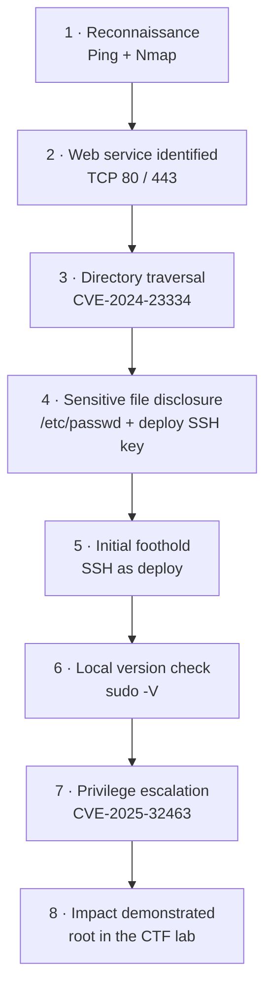

# Attack path — Driftnet

This diagram summarizes the sequence documented in the CTF notes. It represents the reported lab path, not a claim that all underlying package/configuration details were independently verified.

## Stage summary

| Stage | Observation | Security lesson |
|---|---|---|
| Reconnaissance | Ports 22, 80, and 443 were reported open | Enumerate services and versions systematically. |
| File disclosure | Traversal exposed account information and a private key | Never allow public static routes to read outside their intended root. |
| Initial access | The exposed key enabled SSH as `deploy` | Treat private-key exposure as credential compromise and rotate affected keys. |
| Privilege escalation | The lab's `sudo` version was identified as vulnerable | Keep privileged utilities patched and check vendor backports. |
| Final impact | Root access was obtained in the authorized CTF | Record minimal proof and redact secrets before publishing. |

## ATT&CK mapping

- **T1046 — Network Service Discovery:** Nmap-based service enumeration.
- **T1595.002 — Vulnerability Scanning:** probing versions and investigating possible CVEs.
- **T1005 — Data from Local System:** sensitive local files were read through traversal.
- **T1078 — Valid Accounts:** a recovered SSH credential was used for `deploy`.
- **T1068 — Exploitation for Privilege Escalation:** local `sudo` flaw used to obtain root.

References: [MITRE ATT&CK](https://attack.mitre.org/), [CVE-2024-23334 advisory](https://github.com/aio-libs/aiohttp/security/advisories/GHSA-5h86-8mv2-jq9f), [CVE-2025-32463 advisory](https://github.com/advisories/GHSA-695j-c63m-mvxc).
